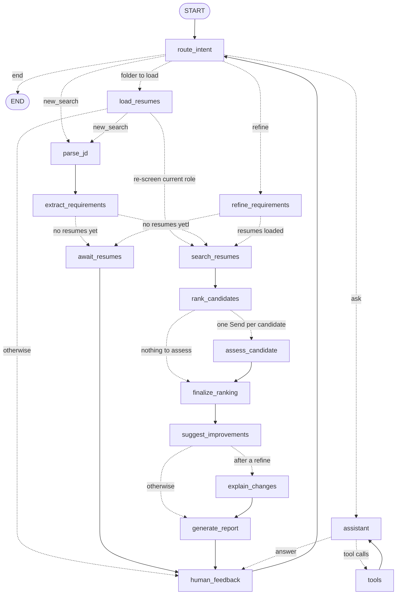

# Agentic Profile Matching

A LangGraph agent that screens resumes against a job description, explains every
ranking it makes, and refines the search through conversation. It is built on a
retrieval engine (`profile_matching/rag/`):
- file tools that read PDF, DOCX and text resumes;
- a ChromaDB index of resumes chunked by section, with extracted skills, experience and education;
- a hybrid semantic + keyword matcher with must-have checks.

```
you> Find me candidates with React and 3+ years experience
Screened 100 resumes; 10 pass every must-have. Deep analysis of 10 in parallel. Final round: hire / no-hire.
you> Compare the top 3 matches side by side
you> Why did the top candidate rank higher than the second?
you> Make TypeScript a must-have
you> Write 3 interview questions for the top candidate
```

| Capability | Where it lives |
| --- | --- |
| **Agent architecture**: state, graph, tools | `matching_agent.py` (graph), `profile_matching/agent/` (state, nodes, routing), `profile_matching/tools/` |
| **Interactive features**: natural-language queries, refinement with re-ranking and explanations | `profile_matching/cli.py`, `agent/routing.py`, `changes.py` |
| **Advanced capabilities**: multi-round screening, explainability | `screening.py`, `guardrails.py`, `explainability.py`, `reports.py` |

## Installation

Requires Python 3.11+ and a chat model: OpenAI by default, or Anthropic,
Google Gemini, a local Ollama server or any OpenAI-compatible server (see
[Chat model providers](#chat-model-providers)).

```bash
pip install "profile-match[ocr] @ git+https://github.com/Akshay-Jhijhautia/Agentic-Profile-Matching.git"
export OPENAI_API_KEY=sk-...        # or put it in ./.env or ~/.profile-match/.env
```

The `[ocr]` extra reads scanned PDFs and image resumes (about 180 MB more);
leave it out if all your resumes have a text layer. To work on the code:

```bash
git clone --depth 1 https://github.com/Akshay-Jhijhautia/Agentic-Profile-Matching.git
cd Agentic-Profile-Matching
python3 -m venv .venv && source .venv/bin/activate
pip install -r requirements.txt     # editable install with OCR, dev tools and every provider
```

Or run it in Docker (see [Docker](#docker)).

## Quick start

```bash
# Chat: describe the role, then load resumes (or the other way round)
profile-match chat
you> /resumes ~/Downloads/backend-applicants          # a folder: 5 or 500 resumes
you> /add ~/Downloads/jane.pdf ~/Downloads/raj.docx   # or individual files (drag them in)

# One-shot screening: the job description first, the resumes last
profile-match screen --jd-file job.pdf --resumes ~/Downloads/backend-applicants
profile-match screen "Senior React developer, 3+ years" --resumes jane.pdf raj.docx

# Pick up a conversation later
profile-match sessions
profile-match chat --session 20261022-1640-a3f2
```

Resumes can be PDF, DOCX, TXT, MD, scanned PDFs or PNG/JPG images. Every
screening saves `reports/<role>-<timestamp>/summary.md` (in the current
folder) plus one detailed report per shortlisted candidate. Chat commands:
`/resumes <folder>`, `/add <files>`, `/report`, `/reset`, `/help`, `/exit`.
From a source checkout, `python main.py ...` runs the same commands.

## Commands

| Command | What it does |
| --- | --- |
| `profile-match chat [--resumes PATH ...] [--session ID]` | Chat with the agent; resume a saved session with `--session` |
| `profile-match screen "request" \| --jd-file JD --resumes PATH ...` | One-shot screening; prints the report and saves all reports |
| `profile-match index FOLDER [--embedder openai\|hashing]` | Index or refresh a folder without screening |
| `profile-match list FOLDER` | The candidates indexed from a folder |
| `profile-match sessions [--delete ID]` | Saved chat sessions, newest first: id, date, role, resumes |
| `profile-match clean [--older-than DAYS] [--yes]` | Old upload batches and sessions (default 30 days), and indexes of deleted folders; lists them, deletes with `--yes` |
| `profile-match --version` | The installed version |

### Local data

Everything the tool keeps lives in one folder, `~/.profile-match`
(`PROFILE_MATCH_HOME`):

| Path | Contents |
| --- | --- |
| `index/` | One ChromaDB index per resume folder or upload batch |
| `uploads/` | Copies of resumes given as files, one batch per chat or file set |
| `sessions.sqlite` | Saved chat sessions (LangGraph checkpoints) |
| `.env` | Optional settings, e.g. `OPENAI_API_KEY` |

Every chat is saved as it goes. `profile-match chat --session <id>` restores
it, with the role, results, history and resumes (reloaded from their folder).

## Docker

```bash
docker build -t profile-match .
docker run --rm -it -e OPENAI_API_KEY \
    -v ~/.profile-match:/data -v "$PWD":/work \
    profile-match chat --resumes ./applicants
```

The image includes OCR, with its models downloaded at build time, and runs as
a non-root user. For another provider, build with its extra
(`--build-arg EXTRAS=ocr,anthropic`) and pass its settings with `-e`. `/data` keeps indexes, uploads and sessions between runs;
`/work` is your folder of resumes and job descriptions, where reports are
written.

## Your resumes

Give the agent a folder or individual resume files, at startup (`--resumes`) or
at any point in the chat: `/resumes <folder>`, `/add <file> ...`, or in plain
English ("screen the resumes in ~/Downloads/backend against ~/jobs/backend.pdf",
"here are jane.pdf and raj.docx"). Dragging a file into the terminal pastes its
path. The agent never ships with resumes of its own: if you describe a role
before loading any, it notes the requirements and asks for resumes.

- **One pool per folder.** Each folder gets its own index, so applicants for
  different jobs never mix and a screening only ranks the active folder. Any
  folder works, and only its top level is read. Loading new resumes keeps the
  current role and re-screens against it.
- **Uploaded files.** Files are copied into a batch under `UPLOADS_DIR`
  (`~/.profile-match/uploads`); the originals are never touched. In chat, every
  `/add` joins the same batch, so they are screened together. A batch is its
  own pool; `/resumes <folder>` switches back to a folder.
- **Automatic, incremental indexing.** New and changed files are indexed and
  deleted ones removed. Unchanged files are recognised by size and modification
  time without being read again.
- **An intake report** says what is ready and what was left out, and why:

  ```
  Resumes in ~/Downloads/backend-applicants: 6 ready (6 new or changed, 0 unchanged).
  Read 1 scanned file(s) with OCR: Jordan_Rivera_CV_scan.pdf.
  Skipped 3 file(s):
  - candidates.xlsx: Unsupported file type '.xlsx'. Supported: .docx, .jpeg, .jpg, .md, .pdf, .png, .txt
  - empty.txt: No text could be extracted. The file may be empty or contain no readable text.
  - old_resume.doc: Legacy Word .doc is not supported; save it as .docx or PDF
  ```

- **Scanned resumes.** PDFs without a text layer and PNG/JPG images are read
  with OCR (RapidOCR, installed with pip; no system dependencies). Each is read
  once, about a second per page. Without the OCR packages, scanned files are
  reported with the install command.
- **Long resumes** are trimmed by section before reaching the model. The
  header, summary, experience, skills and education are kept whole, and only
  lower-priority sections are cut.

```bash
profile-match index ~/Downloads/backend-applicants    # index or refresh a folder without screening
profile-match list ~/Downloads/backend-applicants     # the candidates indexed from it
```

## Architecture



The one-shot graph (`profile-match screen`) is the same pipeline from
`parse_jd` to `generate_report`, ending there. Both come from
`build_graph(services, conversational=...)`. A test keeps this diagram in sync
with the compiled graph.

| Node | What it does |
| --- | --- |
| `route_intent` | Classifies each message: a new role (`new_search`), a change to the current requirements (`refine`), a question (`ask`) or goodbye (`end`), and picks out any resume folder, resume files or JD file it names. Exit words, `/resumes` and `/add` skip the model |
| `load_resumes` | Activates a folder or uploads files, then starts the requested search, re-screens for the current role, or waits |
| `await_resumes` | Requirements are set but no resumes are loaded: lists the requirements and asks for resumes |
| `parse_jd` | Reads the latest message: JD text, a short request or a JD file path |
| `extract_requirements` | Must-have vs nice-to-have requirements ([details](#requirements)) |
| `refine_requirements` | Applies "make Kubernetes a must-have" to the current requirements, as a new version |
| `search_resumes` | **Round 1**: scores and checks every indexed resume |
| `rank_candidates` | Keeps the best `SHORTLIST_SIZE` candidates who pass every must-have |
| `assess_candidate` | **Round 2**, one per shortlisted candidate in parallel (`Send`): deep review of the full resume |
| `finalize_ranking` | Re-ranks by final score, then **round 3**: hire / no-hire by rule, rationale by the model |
| `suggest_improvements` | Borderline candidates: what would make them a clear hire |
| `explain_changes` | After a refinement: what changed in the requirements and the ranking, and why |
| `generate_report` | Shortlist report and chat summary; saves all reports |
| `assistant` ⇄ `tools` | Tool-calling loop for questions, comparisons, explanations, interview questions |
| `human_feedback` | Pauses the graph (`interrupt()`) until the user replies (`Command(resume=...)`) |

### Agent state

`AgentState` (`profile_matching/agent/state.py`) holds:

- **conversation history**: `messages`;
- **job understanding**: `job_description`, the current `requirements` and every version in `requirements_history`;
- **candidates**: `candidates` (every resume, ranked), the `shortlist` (each candidate's scores, must-have checks, reasoning, deep assessment, recommendation and improvement suggestions), the previous screening for change explanations, `assessments` (round-2 cache), `ranking_diff` and the latest `report`.

The in-memory checkpointer keeps one thread per conversation. It registers the
state's Pydantic types with LangGraph's serializer, so checkpoints restore
without deserialization warnings.

## Requirements

`extract_requirements` turns a job description or a short request into
`Requirements`: must-have skills (optionally with minimum years), nice-to-have
skills, minimum total experience and minimum degree. **Must-haves are knockout
filters**, so the model's answer passes through deterministic checks:

1. **Recall floor.** A rule-based JD parser (`job_matcher.parse_job_description`)
   adds vocabulary skills the model skipped (as nice-to-have only) and years it
   found for a must-have the model left without them.
2. **Knockout policy.** A must-have can only reject candidates when the text
   demands it and the resume parser can check it:
   - skills offered as alternatives ("PyTorch or TensorFlow") become nice-to-have;
   - broad concepts outside the skills vocabulary ("Relational Databases") become nice-to-have;
   - a degree is dropped unless a requirement line asks for it without "or equivalent" or "preferred".

Skills are normalised through the shared vocabulary (`react.js` → `React`). A
skill listed without dated experience is `unverified` (kept, flagged), unless the
candidate's whole career is shorter than the years required.

## Multi-round screening

| Round | What happens | LLM calls |
| --- | --- | --- |
| **1. Initial screen** | Every resume (100) gets the hybrid retrieval score (semantic 50% + BM25 keyword 20% + must-have skill coverage 30%) and the must-have checks. The best 10 passing candidates go on | none |
| **2. Deep analysis** | The model reviews each shortlisted resume in parallel, giving a verdict per requirement with a verbatim quote. Code checks the verdicts and computes the **deep score**. Final score = **0.6 × deep + 0.4 × retrieval** | one per candidate, cached |
| **3. Final decision** | A fixed rule decides hire / no-hire and its confidence. One call writes the rationales. Final scores 60–74 are **borderline** and get improvement suggestions | two for the cohort |

A full three-round screen of 100 resumes takes about 40 seconds with
`gpt-5.6-terra`, almost all of it the parallel deep reviews.
`SCREENING_ROUNDS=1` or `2` stops earlier.

## Guardrails

The agent is designed so that **the model judges and code decides**. Results
then depend as little as possible on which model is plugged in or on a given
run (`profile_matching/guardrails.py`):

| Guardrail | What it prevents |
| --- | --- |
| **Rubric scoring.** The model returns only categorical verdicts (strong / partial / missing). Code computes the deep score: must-haves 70%, nice-to-haves 30%; strong 1, partial 0.5, missing 0; minus risk penalties (low 2, medium 5, high 10, at most 20) | Free-form scores drifting between runs and models |
| **Evidence grounding.** Every verdict cites a verbatim quote, and code checks it is in the resume. A quote that isn't downgrades the verdict | Credit for invented experience |
| **Facts bound verdicts.** A must-have that round 1 *measured* as met (years, experience, degree) counts as strong; an unverified one counts as exactly partial; a listed skill can't be missing | The model contradicting what code measured |
| **Decision rule.** Hire when final ≥ 75, no must-have missing and no high-severity risk. Confidence comes from the margin and evidence quality. The model only explains | Different hiring decisions for the same evidence |
| **Stable search text.** The semantic query is rendered only from the structured requirements, never from model-written prose | Rewording reordering the shortlist |
| **Prompt-injection defence.** Resume text is marked as untrusted data in every prompt, and code flags instruction-like text ("ignore previous instructions…") as a high-severity risk | A resume steering its own evaluation |
| **Validated, retried output.** Every structured answer is validated against its schema and retried once with the error | Malformed answers breaking the pipeline |
| **Readiness and recovery.** The CLI checks the index and API key up front. A failed turn is recorded and the conversation continues, with unanswered tool calls closed | A dead or inconsistent chat |

Every adjustment is visible. The detailed report has a "guardrail note" next
to any verdict code changed, and each recommendation shows the rule that
produced it.

**Measured effect** (`scripts/stability_check.py`, 3 identical runs, React request):

| | before guardrails | gpt-5.6-terra | gpt-6-luna |
| --- | --- | --- | --- |
| Deep-score spread for one candidate across runs | up to 24 points | mean 6.5 | mean 2.1 |
| Same top 10 across runs | – | 100% | 100% |
| Same hire / no-hire decisions across runs | – | 100% | 100% |

Across both models on the frontend JD, the ranking was identical (Kendall tau
1.0) and 2 of 3 hire decisions matched. The candidate sitting at the threshold
differed.

```bash
python -m scripts.generate_sample_resumes /tmp/sample_resumes     # see "Sample data"
python -m scripts.stability_check "React and 3+ years experience" --resumes /tmp/sample_resumes --runs 3
python -m scripts.stability_check tests/fixtures/job_descriptions/frontend_react.txt \
    --resumes /tmp/sample_resumes --runs 2 --models gpt-5.6-terra,gpt-6-luna
```

`--models` also takes `provider:model`, to compare providers
(`--models gpt-5.6-terra,anthropic:claude-opus-5-5`).

## Iterative refinement

"Make Kubernetes a must-have", "5+ years of React instead", "drop the degree
requirement" or "TypeScript is only nice to have" edit the current
requirements and re-rank every resume. `explain_changes`
(`profile_matching/changes.py`) then computes, deterministically:

- **the requirement edits**, e.g. "React: 3+ yrs → 5+ yrs";
- **every candidate who entered, left or moved**, with a reason, one of:
  - a must-have they now fail or no longer fail;
  - the score component whose weighted change moved them most ("deep analysis 79 → 89", "semantic fit 56% → 76%");
  - when their own scores don't explain the move, the candidates knocked out above them or who overtook them.

The report gains a "What changed" table, the chat reply opens with a short
narrative of that diff (the model may only cite the computed reasons), and the
assistant sees the changes, so "who dropped out and why?" is answered from them.

## Explainability

- **Shortlist report** (`summary.md`, shown in chat):
  - requirements, then what changed (after a refinement);
  - a table of final / retrieval / deep scores, must-have status and recommendations;
  - per candidate: the decision with its rule and rationale, the deep-analysis summary, strengths, gaps, improvement suggestions (if borderline) and retrieval reasoning;
  - the closest knocked-out candidates.
- **Detailed match report** per candidate (`candidates/NN-<id>.md`, or ask "show me Maria's report"):
  - how the score adds up: each component's value, weight and points;
  - must-have checks;
  - evidence per requirement, with any guardrail notes;
  - strengths, gaps and risk flags with severity;
  - improvement suggestions: the gap, what the candidate could do, how to verify it;
  - resume excerpts.
- **Change explanations** after every refinement (above).

All reports are rendered by code from computed results, so they never disagree
with the ranking. In chat, a candidate report is shown verbatim, and the
assistant only adds a takeaway.

## Agent tools

`make_tools(services)` builds the tools. Each takes its description and
argument docs from its docstring. Expected failures (unknown candidate, bad
input, unreadable file) return `{"success": false, "error": ...}` so the model
can recover.

| Tool | Purpose |
| --- | --- |
| `read_file`, `list_files`, `search_in_file` | Read, list and keyword-search resume and JD files (PDF, DOCX, TXT, MD) |
| `write_file` | Save Markdown or text, only inside `REPORTS_DIR` |
| `rag_search(query, k)` | Hybrid semantic + keyword search across all resumes, for open questions |
| `extract_requirements(jd)` | Must-have vs nice-to-have from JD text, a request or a JD file |
| `compare_candidates(candidate_ids)` | 2–5 candidates head to head on their final scores, checks and decisions, with a verdict |
| `generate_interview_questions(candidate_id, count)` | Questions aimed at the candidate's gaps, unverified claims and strengths |
| `get_candidate_report(candidate_id)` | The detailed match report of a screened candidate |

Candidates are referred to by id (resume file stem without `resume_`, e.g.
`maria_garcia`), full name or a unique part of a name; an ambiguous name lists
the matching ids. Tools that need the current role or shortlist read them from
the graph state (`InjectedState`), invisible to the model.

## Sample session

From a live run with `gpt-5.6-terra` on the 100-resume index (abridged):

```
you> Find me candidates with React and 3+ years experience
Starting a new search…
Must have: React (3+ yrs)
Screened 100 resumes; 10 pass every must-have.
Deep analysis of anika_laurent: 100        (… 10 in parallel)
Final round: 8 hire, 2 no hire.
[Shortlist report]
Screened 100 resumes for React Developer: 10 meet every must-have. Top matches: Anika Laurent (90),
Ethan Khan (89), … Reports saved to reports/react-developer-20261022-151949.

you> Compare the top 3 matches side by side
→ compare_candidates(candidate_ids=["anika_laurent", "ethan_khan", "maria_garcia"])
[side-by-side table: score, must-have status, key strengths, gaps / risks]
Verdict: Advance Anika first: all three pass the must-have, but she has the most directly relevant
frontend, accessibility and testing evidence…

you> Make TypeScript a must-have
Updated the requirements:
Must have: React (3+ yrs), TypeScript
Screened 100 resumes; 8 pass every must-have.
Ranking changes: 0 new, 2 dropped, 6 up, 1 down
With TypeScript now a must-have, Ethan Khan and Hassan Nguyen left the shortlist because their
resumes do not show TypeScript…
| Lucia Lim    | ▲ 8 → 3          | 83 → 89 | score 83 → 89 (semantic fit 61% → 74%) |
| Ethan Khan   | ▼ left (now #12) | 89 → 60 | now fails no TypeScript on resume (needs TypeScript) |

you> Write 3 interview questions for the top candidate
→ generate_interview_questions(candidate_id="anika_laurent", count=3)
 1 React architecture: At Summit Learning, you owned the checkout flow using TypeScript and WCAG
   practices. How did you structure the React components, manage form and async submission state…
 2 Redux and performance: You introduced Redux and reported a 19% Lighthouse improvement. What
   problem required Redux, …
 3 TypeScript standards: While setting React standards and mentoring engineers, what TypeScript
   conventions did you establish…
```

## Chat model providers

One chat model runs every LLM step: requirement extraction, deep review,
rationales, the assistant and the indexer's metadata fallback. Pick it with
`LLM_PROVIDER` and `LLM_MODEL`:

| `LLM_PROVIDER` | Install | Key | Default `LLM_MODEL` |
| --- | --- | --- | --- |
| `openai` (default) | included | `OPENAI_API_KEY` | `gpt-5.6-terra` |
| `anthropic` | `pip install 'profile-match[anthropic]'` | `ANTHROPIC_API_KEY` | `claude-opus-5-5` |
| `google` | `pip install 'profile-match[google]'` | `GOOGLE_API_KEY` or `GEMINI_API_KEY` | `gemini-3.1-pro` |
| `ollama` | `pip install 'profile-match[ollama]'` | none | none: set it, e.g. `qwen3:32b` |

Any OpenAI-compatible server (vLLM, LM Studio, OpenRouter, xAI, ...) works
through `openai` with `LLM_BASE_URL`; put its key, if it needs one, in
`LLM_API_KEY`, so your `OPENAI_API_KEY` is never sent to it:

```bash
LLM_BASE_URL=http://localhost:8000/v1 LLM_MODEL=llama-3.3-70b profile-match chat
```

Provider differences are handled in `profile_matching/providers.py`: Claude
gets no temperature and uses its native structured outputs, OpenAI's reasoning
models use the Responses API, and errors name the provider and the setting to
fix. Embeddings are separate: the default `EMBEDDER=openai` still needs
`OPENAI_API_KEY`, so with another provider and no OpenAI key, use
`EMBEDDER=hashing`. Only OpenAI has been tested end to end with live calls; the
other providers are covered by offline tests.

## Configuration

| Variable | Default | Used for |
| --- | --- | --- |
| `LLM_PROVIDER` / `LLM_MODEL` | `openai` / provider default | The chat model (see above) |
| `OPENAI_API_KEY` | — | OpenAI chat model and OpenAI embeddings |
| `ANTHROPIC_API_KEY`, `GOOGLE_API_KEY` | — | The other providers' chat models |
| `LLM_BASE_URL` / `LLM_API_KEY` | — | An OpenAI-compatible server or a remote Ollama server, and its key |
| `LLM_TEMPERATURE` | provider default | Only for models that accept one (not Claude) |
| `LLM_TIMEOUT` / `LLM_MAX_RETRIES` | `60` / `2` | Request limits |
| `OPENAI_RESPONSES_API` | `true` (`false` with `LLM_BASE_URL`) | OpenAI's Responses API, required for tool calling with reasoning models |
| `OPENAI_EMBEDDING_MODEL` | `text-embedding-3-small` | Resume and query embeddings |
| `PROFILE_MATCH_HOME` | `~/.profile-match` | Local data: indexes, uploads, sessions, `.env` |
| `CHROMA_DB_DIR` / `UPLOADS_DIR` / `SESSIONS_DB` | under `PROFILE_MATCH_HOME` | Override one location |
| `EMBEDDER` | `openai` | Embeddings for new folder indexes: `openai`, or `hashing` (offline, keyword overlap only) |
| `REPORTS_DIR` | `reports` | Where reports are saved; the only directory the agent may write to |
| `SHORTLIST_SIZE` | `10` | Candidates kept after round 1 |
| `SCREENING_ROUNDS` | `3` | 1: retrieval only; 2: + deep analysis; 3: + hire / no-hire |
| `SAVE_REPORTS` | `true` | Save reports after every screening |

Settings come from the environment, then `./.env`, then
`~/.profile-match/.env`. The older `OPENAI_MODEL`, `OPENAI_TEMPERATURE`,
`OPENAI_TIMEOUT` and `OPENAI_MAX_RETRIES` still work for the OpenAI provider.
No API key? `profile-match index <folder> --embedder
hashing` builds an offline index (also `EMBEDDER=hashing`) for trying `index`
and `list`. The agent itself needs a chat model.

## Project layout

| Path | Purpose |
| --- | --- |
| `pyproject.toml` | Package metadata, dependencies (`ocr`, provider and `dev` extras) and the `profile-match` command |
| `profile_matching/app.py` | The `profile-match` command line |
| `profile_matching/agent/graph.py` | The LangGraph graph (`build_graph`, `screen`) |
| `matching_agent.py`, `main.py` | Entry points for a source checkout (re-export the graph; run the CLI) |
| `profile_matching/sessions.py` | Saved chat sessions in SQLite |
| `profile_matching/maintenance.py` | Finding and removing old uploads, orphaned indexes and old sessions |
| `Dockerfile` | Container image with OCR |
| `profile_matching/pools.py` | One resume pool per folder: indexing, incremental sync, intake report |
| `profile_matching/agent/` | `graph.py`, `state.py` (state, checkpointer), `nodes.py`, `routing.py`, `text.py` |
| `profile_matching/screening.py` | The three screening rounds |
| `profile_matching/guardrails.py` | Review items, evidence grounding, verdict bounds, rubric, decision rule, injection checks |
| `profile_matching/requirements.py` | Requirement extraction with rule floor and knockout policy |
| `profile_matching/changes.py` | Requirement and ranking diffs with a reason for every move |
| `profile_matching/explainability.py` | Per-candidate score breakdown, strengths and gaps, detailed report, saving |
| `profile_matching/reports.py` | Shortlist report, chat summary, assistant context |
| `profile_matching/analysis.py` | Comparison, interview questions and report lookup behind the tools |
| `profile_matching/tools/` | Agent tools, built per `Services` by factories |
| `profile_matching/cli.py` | Rich terminal chat driving the human feedback loop |
| `profile_matching/llm.py` | The single path to the chat model: `structured(...)`, `with_tools(...)` |
| `profile_matching/providers.py` | Chat model providers: how each is built, its key, its quirks, its error messages |
| `profile_matching/schemas.py` | Pydantic models shared across the agent |
| `profile_matching/prompts.py` | All prompt templates |
| `profile_matching/services.py`, `candidates.py`, `config.py`, `markdown.py` | Shared dependencies, candidate lookup, settings, Markdown helpers |
| `profile_matching/rag/` | Retrieval engine: `fs_tools` (read, list, search files), `ocr` (scanned PDFs and images), `resume_rag` (section chunking, metadata extraction, ChromaDB index), `job_matcher` (JD parsing, hybrid search, must-have checks), `skills_vocab` (skill aliases) |
| `scripts/` | Sample resume generator, stability check (development tools, not part of the product) |
| `tests/` | Offline pytest suite; `tests/fixtures/` holds 12 sample resumes and 3 sample JDs |

## Sample data

The repository ships no resumes. For demos and evaluation,
`scripts/generate_sample_resumes.py` writes fictional resumes to any folder:
- 12 hand-written samples (also the test fixtures);
- seeded synthetic ones from `scripts/synthetic_resumes.py`, up to `--count`.

The synthetic resumes cover:
- **11 role families**: frontend, full-stack, Python and Java backend, data science, ML, data engineering, DevOps, iOS, Android and QA;
- **seniority** from junior to lead, with overlapping skills;
- **varied formats**: different header and date styles;
- **edge cases**: career changers, missing degrees, certifications.

```bash
python -m scripts.generate_sample_resumes /tmp/sample_resumes             # 100 resumes
python -m scripts.generate_sample_resumes /tmp/more --count 250 --seed 7
profile-match chat --resumes /tmp/sample_resumes
```

The same seed always produces the same resumes. The measurements and the
sample session in this README use the default 100.

## Testing

```bash
pytest -q
```

The suite (over 400 tests) runs offline. A fake chat model answers structured
calls and scripts tool-calling turns, and ChromaDB runs on a temporary index
built with a hashing embedder. It covers:
- the retrieval engine (file reading, chunking, metadata extraction, indexing, hybrid search);
- requirement extraction and the knockout policy;
- every guardrail;
- the three rounds;
- refinement diffs;
- reports;
- the tools;
- full multi-turn conversations through the real graph, including interrupts, refinements and error recovery.

## Design decisions

- **The model judges, code decides.** Scores, knockouts, hire decisions and
  reports are computed. The model reads resumes, gives categorical verdicts
  with quotes and writes explanations. This is what makes results stable
  across runs and auditable.
- **Must-haves are knockouts, so they are policed.** A must-have can only reject
  a candidate when the JD demands it outright and the parser can verify it.
- **Round 1 covers the whole index.** Screening scores every resume rather than
  a retrieval pool, so no qualifying candidate is missed. LLM cost is spent
  only on the shortlist.
- **One record per candidate.** `CandidateMatch` builds up through the rounds,
  so ranking, change explanations, reports and the assistant all read the same
  numbers.
- **Dependencies are injected.** `Services` holds the index, matcher, settings
  and model. Tools and nodes are built around it, so tests swap in fakes with
  no globals.
- **The human loop is in the graph.** The feedback loop is a LangGraph
  `interrupt()`, so the conversation is checkpointed state rather than CLI glue.

## Limitations

- **Embeddings still need OpenAI** (or the keyword-only hashing embedder),
  whichever chat provider is used.
- **Models can disagree** on candidates near the hire threshold, and only
  OpenAI's models have been measured (see the stability check). Next steps:
  - local embeddings;
  - letting rules decide or recruiters confirm the extracted requirements;
  - a reproducibility cache for LLM outputs.
- **Heuristic skill years.** A skill's years come from the dated roles that
  mention it, so skills listed only in a Skills section are "unverified".
- **Blind screening isn't implemented.** Names and contact details reach the
  model during deep analysis.
- **Synthetic data.** The semantic score range was calibrated on the generated
  sample resumes; real resumes may need it re-tuned. OCR was tested on clean scans; low-quality
  photos and handwriting will read worse.
- **Unsupported formats.** Legacy `.doc`, `.rtf` and `.odt` aren't read; they
  are reported so they can be converted. Subfolders of a resume folder aren't
  read either.
- **Uploads accumulate** until `profile-match clean` removes them.
- **Install size.** ChromaDB brings large dependencies (a Kubernetes client,
  ONNX Runtime, gRPC): the base install is about 500 MB. A lighter local vector
  store would cut most of it.
