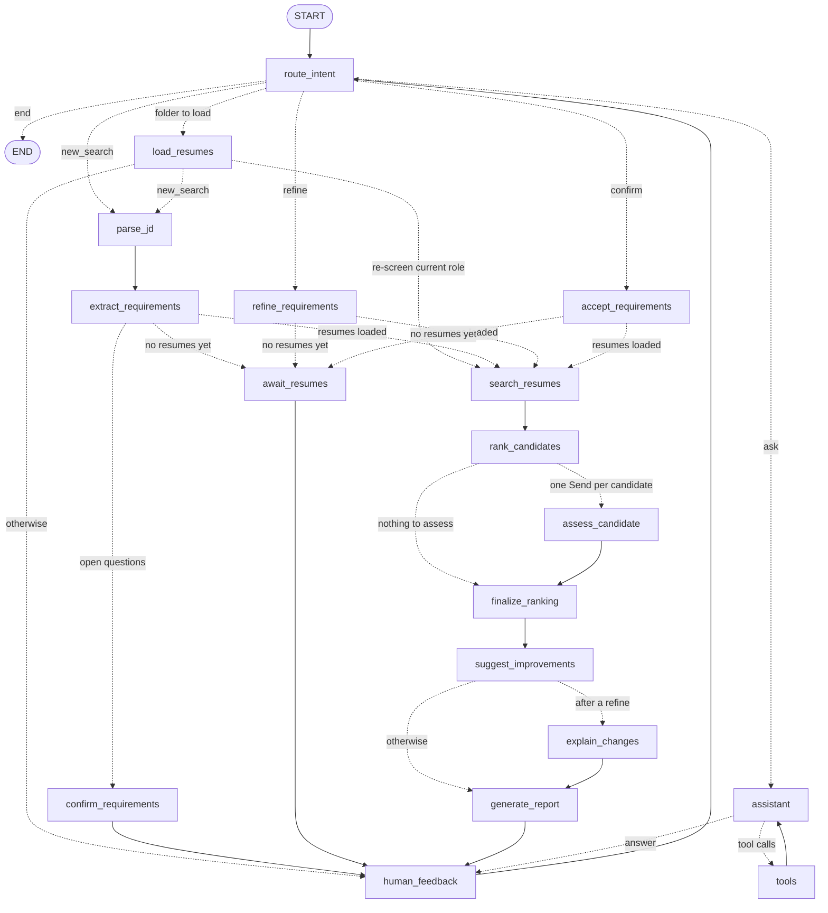

# How it works

The agent's design: what each step does, which parts the model judges and which rules decide, and how results are kept explainable and reproducible.

## Architecture



The one-shot graph (`resume-shortlister screen`) is the same pipeline from
`parse_jd` to `generate_report`, ending there. Both come from
`build_graph(services, conversational=...)`. A test keeps this diagram in sync
with the compiled graph.

| Node | What it does |
| --- | --- |
| `route_intent` | Classifies each message: a new role (`new_search`), a change to the current requirements (`refine`), accepting requirements it was asked to check (`confirm`), a question (`ask`) or goodbye (`end`), and picks out any resume folder, resume files or JD file it names. Exit words, a plain "yes" to a confirmation, `/resumes` and `/add` skip the model |
| `load_resumes` | Activates a folder or uploads files, then starts the requested search, re-screens for the current role, or waits |
| `await_resumes` | Requirements are set but no resumes are loaded: lists the requirements and asks for resumes |
| `parse_jd` | Reads the latest message: JD text, a short request or a JD file path |
| `extract_requirements` | Must-have vs nice-to-have requirements ([details](#requirements)) |
| `confirm_requirements` | Only when the job description leaves a must-have open (a requirement naming several skills where the model kept only some): asks the recruiter to confirm or change it before screening |
| `accept_requirements` | The recruiter accepted the requirements as proposed: screening starts |
| `refine_requirements` | Applies "make Kubernetes a must-have" to the current requirements, as a new version |
| `search_resumes` | **Round 1**: scores and checks every indexed resume |
| `rank_candidates` | Keeps the best `SHORTLIST_SIZE` candidates who pass every must-have |
| `assess_candidate` | **Round 2**, one per shortlisted candidate in parallel (`Send`): deep review of the full resume |
| `finalize_ranking` | Re-ranks by final score, then **round 3**: recommend interview or not now, by rule; rationale by the model |
| `suggest_improvements` | Borderline candidates: what would make them a clear interview |
| `explain_changes` | After a refinement: what changed in the requirements and the ranking, and why |
| `generate_report` | Shortlist report and chat summary; saves all reports |
| `assistant` ⇄ `tools` | Tool-calling loop for questions, comparisons, explanations, interview questions |
| `human_feedback` | Pauses the graph (`interrupt()`) until the user replies (`Command(resume=...)`) |

### Agent state

`AgentState` (`resume_shortlister/agent/state.py`) holds:

- **conversation history**: `messages`;
- **job understanding**: `job_description`, the current `requirements` and every version in `requirements_history`;
- **candidates**: `candidates` (every resume, ranked), the `shortlist` (each candidate's scores, must-have checks, reasoning, deep assessment, recommendation and improvement suggestions), the previous screening for change explanations, `assessments` (round-2 cache), `ranking_diff` and the latest `report`.

The in-memory checkpointer keeps one thread per conversation. It registers the
state's Pydantic types with LangGraph's serializer, so checkpoints restore
without deserialization warnings.

## Requirements

`extract_requirements` turns a job description or a short request into
`Requirements`: must-have skills (optionally with minimum years), nice-to-have
skills, minimum total experience and minimum degree. **Must-haves are knockout
filters**, so they must not depend on which model, or which run, read the job
description. The model proposes; **rules decide wherever the text is explicit**
(`requirements.apply_rules`):

- **Must-haves.** Never a skill in a "preferred" section or a softened phrase
  ("familiarity with", "a plus"), one of several options ("Oracle or
  PostgreSQL", "Kubernetes or similar"), a skill mentioned only outside the
  requirements section, or a concept the resume parser cannot check
  ("Relational Databases"). A requirement naming one skill makes it a must-have,
  even if the model missed it. Only requirements naming several skills
  ("deploying models with Docker and Kubernetes on AWS") are the model's call.
- **Years** come from the text, not the model: "3+ years with React and
  Node.js" sets both; "React and 3+ years" ties the years to React; "6+ years
  of software development" is total experience.
- **Degree** only when a requirement asks for it without "or equivalent" or
  "preferred".
- **Nice-to-haves** are every other skill the text names, plus the model's
  non-skill preferences ("financial services").

Measured with `scripts/requirements_stability.py` (7 JDs and 3 requests, 5 runs
each with gpt-5.6-terra and gpt-6-luna), the share of runs that agree:

| | before | with rules |
| --- | --- | --- |
| total years | 0.85 | 1.00 |
| years per must-have | 0.77 | same as the must-haves |
| nice-to-have skills | 0.57 (with wording) | same as the must-haves |
| must-haves | 0.88 | 0.86 |
| degree | 1.00 | 1.00 |

What still varies is exactly the multi-skill lines (is "iOS" a must-have next
to Swift? Prometheus and Grafana?), the cases a recruiter should settle. So in
chat, when a requirement names several skills and the model kept only some (or
none) as must-haves, the agent asks before screening:

```
Before screening, please check what the job description leaves open:
- "4+ years of professional iOS development in Swift": **Swift** must-have, **iOS** only nice-to-have.

Reply **yes** to screen with these, or say what to change (for example "make iOS a must-have").
```

"yes" screens as proposed; any change is applied as a refinement first. Clear
requirements ("Strong Java and Spring Boot skills") never trigger a question:
over the same 10 inputs and 10 runs each, 6 inputs were never asked about, and
the ML job description, the ML request and the iOS role were asked about in
most runs. When the model reads a multi-skill line strictly (every skill a
must-have) nothing is asked, since that can only knock candidates out, never
let a weak one in.
`resume-shortlister screen` cannot ask: it screens as proposed and lists the open
points under **Please check** in the report.

Skills are normalised through the shared vocabulary (`react.js` → `React`). A
skill listed without dated experience is `unverified` (kept, flagged), unless the
candidate's whole career is shorter than the years required.

## Multi-round screening

| Round | What happens | LLM calls |
| --- | --- | --- |
| **1. Initial screen** | Every resume (100) gets the hybrid retrieval score (semantic 50% + BM25 keyword 20% + must-have skill coverage 30%) and the must-have checks. The best 10 passing candidates go on | none |
| **2. Deep analysis** | The model reviews each shortlisted resume in parallel, giving a verdict per requirement with a verbatim quote. Code checks the verdicts and computes the **deep score**. Final score = **0.6 × deep + 0.4 × retrieval** | one per candidate, cached |
| **3. Recommendation** | A fixed rule recommends an interview or not now, with a confidence. One call writes the rationales. Final scores 60–74 are **borderline** and get improvement suggestions | two for the cohort |

A full three-round screen of 100 resumes takes about 40 seconds with
`gpt-5.6-terra`, almost all of it the parallel deep reviews.
`SCREENING_ROUNDS=1` or `2` stops earlier.

## Guardrails

The agent is designed so that **the model judges and code decides**. Results
then depend as little as possible on which model is plugged in or on a given
run (`resume_shortlister/guardrails.py`):

| Guardrail | What it prevents |
| --- | --- |
| **Rubric scoring.** The model returns only categorical verdicts (strong / partial / missing). Code computes the deep score: must-haves 70%, nice-to-haves 30%; strong 1, partial 0.5, missing 0; minus risk penalties (low 2, medium 5, high 10, at most 20) | Free-form scores drifting between runs and models |
| **Evidence grounding.** Every verdict cites a verbatim quote, and code checks it is in the resume. A quote that isn't downgrades the verdict | Credit for invented experience |
| **Facts bound verdicts.** A must-have that round 1 *measured* as met (years, experience, degree) counts as strong; an unverified one counts as exactly partial; a listed skill can't be missing | The model contradicting what code measured |
| **Decision rule.** Recommend an interview when final ≥ 75, no must-have missing and no high-severity risk. Confidence comes from the margin and evidence quality. The model only explains | Different recommendations for the same evidence |
| **Blind screening.** Every model call that judges or compares candidates gets them anonymous: labels instead of names and ids, resumes without name, contact details or personal fields ([below](#blind-screening)) | Who the candidate is influencing the judgement |
| **Stable search text.** The semantic query is rendered only from the structured requirements, never from model-written prose | Rewording reordering the shortlist |
| **Prompt-injection defence.** Resume text is marked as untrusted data in every prompt, and code flags instruction-like text ("ignore previous instructions…") as a high-severity risk | A resume steering its own evaluation |
| **Validated, retried output.** Every structured answer is validated against its schema and retried once with the error | Malformed answers breaking the pipeline |
| **Readiness and recovery.** The CLI checks the index and API key up front. A failed turn is recorded and the conversation continues, with unanswered tool calls closed | A dead or inconsistent chat |

Every adjustment is visible. The detailed report has a "guardrail note" next
to any verdict code changed, and each recommendation shows the rule that
produced it.

**Measured effect** (`scripts/stability_check.py`, 3 identical runs, React request):

| | before guardrails | gpt-5.6-terra | gpt-6-luna |
| --- | --- | --- | --- |
| Deep-score spread for one candidate across runs | up to 24 points | mean 6.5 | mean 2.1 |
| Same top 10 across runs | – | 100% | 100% |
| Same interview recommendations across runs | – | 100% | 100% |

Across both models on the frontend JD, the ranking was identical (Kendall tau
1.0) and 2 of 3 interview recommendations matched. The candidate sitting at the threshold
differed.

```bash
python -m scripts.generate_sample_resumes /tmp/sample_resumes     # see development.md: Sample data
python -m scripts.stability_check "React and 3+ years experience" --resumes /tmp/sample_resumes --runs 3
python -m scripts.stability_check tests/fixtures/job_descriptions/frontend_react.txt \
    --resumes /tmp/sample_resumes --runs 2 --models gpt-5.6-terra,gpt-6-luna
```

`--models` also takes `provider:model`, to compare providers
(`--models gpt-5.6-terra,anthropic:claude-opus-5-5`).

## Blind screening

Who a candidate is should play no part in judging them, so the model never
learns it (`rag/personal_data.py`, `candidates.blind_resume`, `anonymous.py`):

- **What the model reads.** In the deep review, the rationales, the
  improvement suggestions, comparisons and interview questions, the resume
  header's name, contact and location lines are dropped, and elsewhere the
  name, emails, phone numbers, profile links and personal fields (date of
  birth, age, gender, marital status, nationality, citizenship, religion,
  address) are replaced with `[candidate]`, `[email]`, `[phone]`, `[link]` or
  `[removed]`. The prompts say these removals are not gaps or risks.
- **How it names them.** Ids are file names (`anika_laurent`), so candidates
  are "Candidate 1", "Candidate 2" in the model's input, and its answers are
  mapped back: references to ids, labels in its text to names. You read
  "Anika Laurent", never a label.
- **Round 1.** The search embeds and keyword-matches resume text without the
  name or personal details, and a name is never read as a skill: before,
  "Ruby Swift" was credited with Ruby and Swift from her name line.
- **Evidence stays.** Dates, companies, schools and locations inside the work
  history are kept, and a name part that is also a skill or a month ("Swift",
  "May") is hidden only as part of the full name, so "built apps in Swift"
  keeps its evidence. Quotes are checked against the text the model read.

**Measured** on the 100 sample resumes:

- *Search* (`scripts/ranking_eval.py`, 16 queries): knockouts identical in
  every query; P@10 0.921 → 0.921 and AUC 0.994 → 0.995 with the default local
  model; scores moved by 1.5 points or less on average per query (at most 6),
  so the calibration holds.
- *Screening* (`scripts/stability_check.py`, frontend JD, 5 runs each,
  gpt-5.6-terra): the same ranking in every run, blind or not, and the same
  decision agreement. Requirement verdicts were identical across runs; what
  varies is how many risk flags the model lists. The candidate at the
  threshold averaged 64.7 blind against 62.4 with names over 15 deep reviews
  each, often enough to cross the interview threshold, which is where a
  recruiter's second look belongs anyway.
- *Leakage*: across a live screening, comparison and interview questions,
  none of the 100 candidates' names, ids or emails appeared in anything sent
  to the model. A test checks this on every screening.

## Reproducible results

Every structured model answer (requirements, deep reviews, recommendation rationales,
improvement suggestions, comparisons, interview questions, routing) is stored
in `llm_cache.sqlite`, keyed by everything that shapes it: provider, model,
temperature, output schema, the full prompt and the input. Asking the same
question again returns the stored answer, so:

- **the same screening gives the same result**, in every run and session (live:
  identical reports, 27 s for the first run, 0.9 s for the second);
- a changed job description, resume, prompt, model or setting is a new question
  and is answered fresh;
- guardrails and scoring still run on the stored answer, so improvements to
  them apply to earlier answers too;
- each entry keeps the request, the answer, the model, when it was made and how
  often it was reused: an audit trail of what the model was asked and said.

`resume-shortlister cache` shows what is stored, `resume-shortlister cache --clear`
forgets it, and `clean` removes answers unused for 30 days. `LLM_CACHE=false`
asks the model every time; `scripts/stability_check.py` always does, since it
measures the model's own variance. Free-form chat replies are not stored. The
cache holds resume text, like the index, and stays on your machine.

## Iterative refinement

"Make Kubernetes a must-have", "5+ years of React instead", "drop the degree
requirement" or "TypeScript is only nice to have" edit the current
requirements and re-rank every resume. `explain_changes`
(`resume_shortlister/changes.py`) then computes, deterministically:

- **the requirement edits**, e.g. "React: 3+ yrs → 5+ yrs";
- **every candidate who entered, left or moved**, with a reason, one of:
  - a must-have they now fail or no longer fail;
  - the score component whose weighted change moved them most ("deep analysis 79 → 89", "semantic fit 56% → 76%");
  - when their own scores don't explain the move, the candidates knocked out above them or who overtook them.

The report gains a "What changed" table, the chat reply opens with a short
narrative of that diff (the model may only cite the computed reasons), and the
assistant sees the changes, so "who dropped out and why?" is answered from them.

## Explainability

- **Shortlist report** (`summary.md`, shown in chat):
  - requirements, then what changed (after a refinement);
  - a table of final / retrieval / deep scores, must-have status and recommendations;
  - per candidate: the decision with its rule and rationale, the deep-analysis summary, strengths, gaps, improvement suggestions (if borderline) and retrieval reasoning;
  - the closest knocked-out candidates.
- **Detailed match report** per candidate (`candidates/NN-<id>.md`, or ask "show me Maria's report"):
  - how the score adds up: each component's value, weight and points;
  - must-have checks;
  - evidence per requirement, with any guardrail notes;
  - strengths, gaps and risk flags with severity;
  - improvement suggestions: the gap, what the candidate could do, how to verify it;
  - resume excerpts.
- **Change explanations** after every refinement (above).

All reports are rendered by code from computed results, so they never disagree
with the ranking. In chat, a candidate report is shown verbatim, and the
assistant only adds a takeaway.

## Agent tools

`make_tools(services)` builds the tools. Each takes its description and
argument docs from its docstring. Expected failures (unknown candidate, bad
input, unreadable file) return `{"success": false, "error": ...}` so the model
can recover.

| Tool | Purpose |
| --- | --- |
| `read_file`, `list_files`, `search_in_file` | Read, list and keyword-search resume and JD files (PDF, DOCX, TXT, MD) |
| `write_file` | Save Markdown or text, only inside `REPORTS_DIR` |
| `rag_search(query, k)` | Hybrid semantic + keyword search across all resumes, for open questions |
| `extract_requirements(jd)` | Must-have vs nice-to-have from JD text, a request or a JD file |
| `compare_candidates(candidate_ids)` | 2–5 candidates head to head on their final scores, checks and decisions, with a verdict |
| `generate_interview_questions(candidate_id, count)` | Questions aimed at the candidate's gaps, unverified claims and strengths |
| `get_candidate_report(candidate_id)` | The detailed match report of a screened candidate |

Candidates are referred to by id (resume file stem without `resume_`, e.g.
`maria_garcia`), full name or a unique part of a name; an ambiguous name lists
the matching ids. Tools that need the current role or shortlist read them from
the graph state (`InjectedState`), invisible to the model.

## Design decisions

- **The model judges, code decides.** Scores, knockouts, recommendations and
  reports are computed. The model reads resumes, gives categorical verdicts
  with quotes and writes explanations. This is what makes results stable
  across runs and auditable.
- **Must-haves are knockouts, so they are policed.** A must-have can only reject
  a candidate when the JD demands it outright and the parser can verify it.
- **Round 1 covers the whole index.** Screening scores every resume rather than
  a retrieval pool, so no qualifying candidate is missed. LLM cost is spent
  only on the shortlist.
- **Local embeddings by default.** Every company gets the same embeddings,
  whatever chat provider it uses, with no key and no data leaving the machine.
  The model was picked and calibrated by measurement on the sample resumes.
- **Exact search, no vector database.** A pool holds hundreds or a few thousand
  resumes, so comparing the query with every chunk takes milliseconds. Exact
  search never misses a neighbour the way approximate indexes can, and SQLite
  plus NumPy keeps the install small (168 MB instead of 527 MB with ChromaDB).
- **One record per candidate.** `CandidateMatch` builds up through the rounds,
  so ranking, change explanations, reports and the assistant all read the same
  numbers.
- **Dependencies are injected.** `Services` holds the index, matcher, settings
  and model. Tools and nodes are built around it, so tests swap in fakes with
  no globals.
- **The human loop is in the graph.** The feedback loop is a LangGraph
  `interrupt()`, so the conversation is checkpointed state rather than CLI glue.
