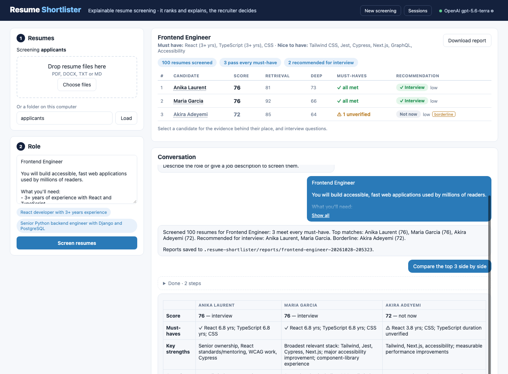
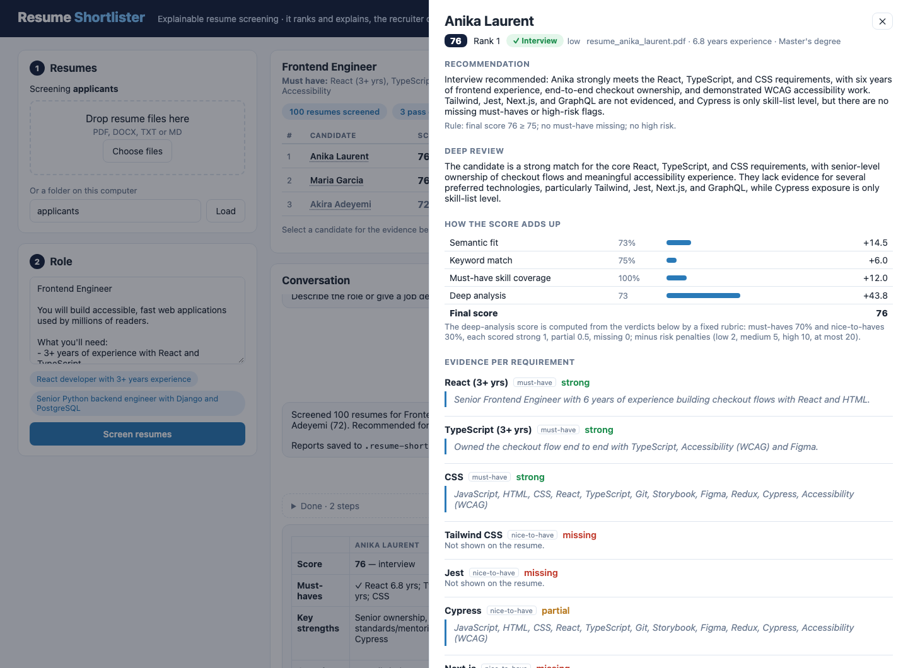

# Using Resume Shortlister

Install it first ([README](../README.md#get-started)). Settings, providers and embeddings are in [Configuration](configuration.md).

## In your browser

```bash
resume-shortlister web     # opens http://127.0.0.1:8765/
```



Drop resume files on the page (or give a folder on this computer), describe
the role or paste the job description, and follow the screening as it runs.
When the description leaves a requirement open, it asks before screening.
Then:

- **The shortlist**: every round's score, the must-have checks and the
  recommendation, with the report to download.
- **A candidate**: select one for the recommendation and the rule behind it,
  how the score adds up, a verdict per requirement with the quote from the
  resume, strengths, gaps and risks, and interview questions aimed at their
  gaps and unverified claims.
- **The conversation**: ask why one candidate ranks above another, compare
  them, or change the role ("make Docker a must-have"); suggested follow-ups
  use your shortlist.
- **Sessions** reopen any earlier screening, and **Settings** show the model,
  whether its key is set, the screening rules and where your data is.



The app runs on this computer only: it listens on 127.0.0.1, answers only
requests addressed to it there, and its API needs a token that only its own
page receives, created at each start. It needs no Node: the interface is built
into the package. Settings are changed in `~/.resume-shortlister/.env` (see
[Configuration](configuration.md)), not in the page, so API keys never pass
through the browser. Developing the interface: [frontend/README.md](../frontend/README.md).

## In the terminal

```bash
# Chat: describe the role, then load resumes (or the other way round)
resume-shortlister chat
you> /resumes ~/Downloads/backend-applicants          # a folder: 5 or 500 resumes
you> /add ~/Downloads/jane.pdf ~/Downloads/raj.docx   # or individual files (drag them in)

# One-shot screening: the job description first, the resumes last
resume-shortlister screen --jd-file job.pdf --resumes ~/Downloads/backend-applicants
resume-shortlister screen "Senior React developer, 3+ years" --resumes jane.pdf raj.docx

# Pick up a conversation later
resume-shortlister sessions
resume-shortlister chat --session 20261022-1640-a3f2
```

Resumes can be PDF, DOCX, TXT or MD. Every
screening saves `reports/<role>-<timestamp>/summary.md` (in the current
folder; the browser app saves them in `~/.resume-shortlister/reports`) plus one
detailed report per shortlisted candidate. Chat commands:
`/resumes <folder>`, `/add <files>`, `/report`, `/reset`, `/help`, `/exit`.
From a source checkout, `python main.py ...` runs the same commands.

## Commands

| Command | What it does |
| --- | --- |
| `resume-shortlister chat [--resumes PATH ...] [--session ID]` | Chat with the agent; resume a saved session with `--session` |
| `resume-shortlister screen "request" \| --jd-file JD --resumes PATH ...` | One-shot screening; prints the report and saves all reports |
| `resume-shortlister index FOLDER [--embedder local\|openai\|hashing]` | Index or refresh a folder without screening |
| `resume-shortlister list FOLDER` | The candidates indexed from a folder |
| `resume-shortlister sessions [--delete ID]` | Saved chat sessions, newest first: id, date, role, resumes |
| `resume-shortlister clean [--older-than DAYS] [--yes]` | Old upload batches and sessions (default 30 days), stored model answers unused that long, indexes of deleted folders, and a ChromaDB index left by versions before 1.1; lists them, deletes with `--yes` |
| `resume-shortlister clean --all [--yes]` | Every piece of candidate data, to start from scratch: every index, uploaded copy, saved session, stored model answer and the web app's reports. Keeps your settings (`.env`) and the embedding model; lists first, deletes with `--yes` |
| `resume-shortlister cache [--clear]` | Stored model answers (see [Reproducible results](how-it-works.md#reproducible-results)); `--clear` deletes them |
| `resume-shortlister web [--port PORT] [--no-browser]` | The app in your browser, on this computer only: screening, candidate details, interview questions and the chat |
| `resume-shortlister --version` | The installed version |

### Local data

Everything the tool keeps lives in one folder, `~/.resume-shortlister`
(`RESUME_SHORTLISTER_HOME`):

| Path | Contents |
| --- | --- |
| `index/index.sqlite` | The index: one collection per resume folder or upload batch |
| `models/` | The local embedding model, downloaded on first use |
| `uploads/` | Copies of resumes given as files, one batch per chat or file set |
| `sessions.sqlite` | Saved chat sessions (LangGraph checkpoints) |
| `llm_cache.sqlite` | Stored model answers, so a repeated screening gives the same result |
| `reports/` | Reports saved by the browser app |
| `.env` | Optional settings, e.g. `OPENAI_API_KEY` |

Every chat is saved as it goes. `resume-shortlister chat --session <id>` restores
it, with the role, results, history and resumes (reloaded from their folder).

## Your resumes

Give the agent a folder or individual resume files, at startup (`--resumes`) or
at any point in the chat: `/resumes <folder>`, `/add <file> ...`, or in plain
English ("screen the resumes in ~/Downloads/backend against ~/jobs/backend.pdf",
"here are jane.pdf and raj.docx"). Dragging a file into the terminal pastes its
path. The agent never ships with resumes of its own: if you describe a role
before loading any, it notes the requirements and asks for resumes.

- **One pool per folder.** Each folder gets its own index, so applicants for
  different jobs never mix and a screening only ranks the active folder. Any
  folder works, and only its top level is read. Loading new resumes keeps the
  current role and re-screens against it.
- **Uploaded files.** Files are copied into a batch under `UPLOADS_DIR`
  (`~/.resume-shortlister/uploads`); the originals are never touched. In chat, every
  `/add` joins the same batch, so they are screened together. A batch is its
  own pool; `/resumes <folder>` switches back to a folder.
- **Automatic, incremental indexing.** New and changed files are indexed and
  deleted ones removed. Unchanged files are recognised by size and modification
  time without being read again.
- **An intake report** says what is ready and what was left out, and why:

  ```
  Resumes in ~/Downloads/backend-applicants: 6 ready (6 new or changed, 0 unchanged).
  Skipped 4 file(s):
  - Jordan_Rivera_CV_scan.pdf: No text layer: this looks like a scanned PDF. Ask the candidate for a text PDF or DOCX
  - candidates.xlsx: Unsupported file type '.xlsx'. Supported: .docx, .md, .pdf, .txt
  - empty.txt: No text could be extracted. The file may be empty or contain no readable text.
  - old_resume.doc: Legacy Word .doc is not supported; save it as .docx or PDF
  ```

- **No OCR.** Candidates send text PDFs or Word files, so scanned PDFs and
  photos are not read. A PDF with almost no text per page is reported as a
  scan, with a request for a text file, rather than indexed as an empty
  resume; PNG/JPG files are reported the same way.
- **Long resumes** are trimmed by section before reaching the model. The
  header, summary, experience, skills and education are kept whole, and only
  lower-priority sections are cut.

```bash
resume-shortlister index ~/Downloads/backend-applicants    # index or refresh a folder without screening
resume-shortlister list ~/Downloads/backend-applicants     # the candidates indexed from it
```

## Docker

```bash
docker build -t resume-shortlister .
docker run --rm -it -e OPENAI_API_KEY \
    -v ~/.resume-shortlister:/data -v "$PWD":/work \
    resume-shortlister chat --resumes ./applicants
```

For the browser app, publish its port on this computer only and open
http://127.0.0.1:8765/:

```bash
docker run --rm -e OPENAI_API_KEY -p 127.0.0.1:8765:8765 \
    -v ~/.resume-shortlister:/data -v "$PWD":/work resume-shortlister web
```

The image runs as a non-root user and includes the embedding model, so indexing
works without network access. `/data` keeps indexes, uploads and
sessions between runs (and the browser app's reports); `/work` is your folder
of resumes and job descriptions, where the terminal's reports are written. For another chat provider, build with its extra
(`--build-arg EXTRAS=anthropic`) and pass its settings with `-e`.

## Sample session

From a live run with `gpt-5.6-terra` on the 100-resume index (abridged):

```
you> Find me candidates with React and 3+ years experience
Starting a new search…
Must have: React (3+ yrs)
Screened 100 resumes; 10 pass every must-have.
Deep analysis of anika_laurent: 100        (… 10 in parallel)
Final round: 8 recommended for interview, 2 not now.
[Shortlist report]
Screened 100 resumes for React Developer: 10 meet every must-have. Top matches: Anika Laurent (90),
Ethan Khan (89), … Reports saved to reports/react-developer-20261022-151949.

you> Compare the top 3 matches side by side
→ compare_candidates(candidate_ids=["anika_laurent", "ethan_khan", "maria_garcia"])
[side-by-side table: score, must-have status, key strengths, gaps / risks]
Verdict: Advance Anika first: all three pass the must-have, but she has the most directly relevant
frontend, accessibility and testing evidence…

you> Make TypeScript a must-have
Updated the requirements:
Must have: React (3+ yrs), TypeScript
Screened 100 resumes; 8 pass every must-have.
Ranking changes: 0 new, 2 dropped, 6 up, 1 down
With TypeScript now a must-have, Ethan Khan and Hassan Nguyen left the shortlist because their
resumes do not show TypeScript…
| Lucia Lim    | ▲ 8 → 3          | 83 → 89 | score 83 → 89 (semantic fit 61% → 74%) |
| Ethan Khan   | ▼ left (now #12) | 89 → 60 | now fails no TypeScript on resume (needs TypeScript) |

you> Write 3 interview questions for the top candidate
→ generate_interview_questions(candidate_id="anika_laurent", count=3)
 1 React architecture: At Summit Learning, you owned the checkout flow using TypeScript and WCAG
   practices. How did you structure the React components, manage form and async submission state…
 2 Redux and performance: You introduced Redux and reported a 19% Lighthouse improvement. What
   problem required Redux, …
 3 TypeScript standards: While setting React standards and mentoring engineers, what TypeScript
   conventions did you establish…
```
